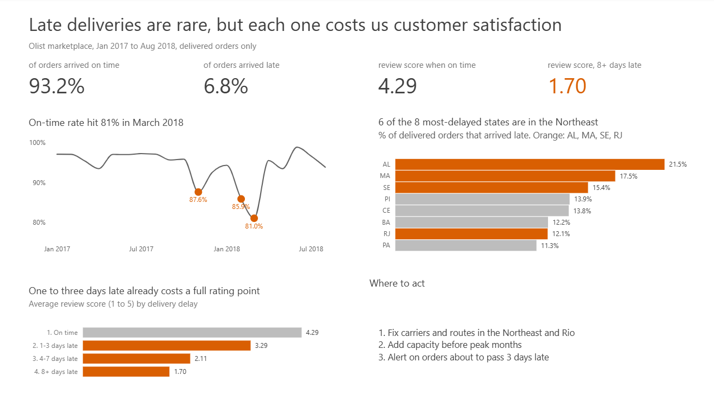

# E-commerce Logistics Performance Analysis

> Delivery performance and customer ratings analysis of a Brazilian e-commerce marketplace, using SQL (MySQL) and Power BI.



## 1. Business problem

Online customers expect orders to arrive on the promised date. Late deliveries hurt customer satisfaction and increase operating costs. This project analyzes where and when deliveries fail, and how much delays affect customer ratings.

## 2. Key questions

1. What is the on-time delivery rate and how does it change month by month?
2. Which states concentrate the most delays?
3. How much do delays reduce customer review scores?

## 3. Dataset

- **Source:** Brazilian E-Commerce Public Dataset by Olist (Kaggle)
- **Size:** about 100k orders, 2016-2018
- **Tables used:** orders, customers, order_reviews
- **Period analyzed:** Jan 2017 to Aug 2018 (96,203 delivered orders). Earlier months have too few orders for a meaningful rate.
- **Scope decision:** only `delivered` orders with a delivery date were used.
- **On time:** delivered on or before the estimated delivery date (day-level comparison).
- **Reviews:** some orders have more than one review, so the score is averaged per order. Orders with no review are excluded from rating metrics.
- **States:** the state ranking only includes states with 100 or more orders.

## 4. Tools

| Tool | Use |
|------|-----|
| MySQL (Workbench) | Data import, analytical views and queries |
| Power BI | Dashboard and DAX measures |

## 5. Method

1. Data import and quality checks (nulls, duplicates, inconsistent dates)
2. Two analytical views in MySQL: `vw_deliveries` (one row per delivered order) and `vw_order_reviews` (one review score per order)
3. One SQL query per business question (see `/sql`)
4. Dashboard in Power BI built on the two views, with DAX measures
5. Insights and recommendations based on the results

## 6. Key insights

- **Insight 1:** On-time delivery was 93.2% across 96,203 delivered orders (Jan 2017 to Aug 2018), but it dropped to 87.6% in November 2017 (peak volume) and hit a low of 81.0% in March 2018.
- **Insight 2:** Delays are concentrated geographically. Alagoas (21.5%), Maranhão (17.5%) and Sergipe (15.4%) had the highest late rates, and six of the eight most-delayed states are in the Northeast. In absolute terms, São Paulo and Rio de Janeiro account for about half of all late orders, and Rio de Janeiro is the only state with more than 10,000 orders and a late rate above 12%.
- **Insight 3:** Delays are strongly associated with lower customer ratings. Orders delivered on time averaged 4.29, versus 3.29 for 1-3 days late, 2.11 for 4-7 days late and 1.70 for 8+ days late.

## 7. Recommendations

1. **Problem:** Late deliveries are concentrated in the Northeast and Rio de Janeiro.
   - **Evidence:** AL (21.5%), MA (17.5%) and SE (15.4%) have the highest late rates, and Rio de Janeiro is the only state with more than 10,000 orders above 12%.
   - **Action:** Review carrier coverage and promised delivery dates in these states, starting with Rio de Janeiro because of its volume.

2. **Problem:** On-time performance drops sharply in some months.
   - **Evidence:** On-time rate fell to 87.6% in November 2017 (peak volume) and to 81.0% in March 2018.
   - **Action:** Plan extra carrier capacity before peak periods, and investigate what happened in February and March 2018, since volume alone does not explain it.

3. **Problem:** Even short delays hurt customer ratings.
   - **Evidence:** Review score falls from 4.29 (on time) to 3.29 with only 1-3 days of delay, and to 1.70 with 8+ days.
   - **Action:** Flag orders at risk of delay early, so customers can be warned or the shipment prioritized before it goes late.

## 8. Repository structure

```
├── data/          # raw data (download from Kaggle, CSVs are too large)
├── sql/
│   ├── 01_create_view.sql
│   ├── 02_q1_on_time_rate_by_month.sql
│   ├── 03_q2_delays_by_state.sql
│   ├── 04_q3_delay_vs_review_score.sql
│   └── 05_create_view_reviews.sql
├── dashboard/     # olist_logistics_dashboard.pbix
├── docs/          # dashboard_preview.png
└── README.md
```

## 9. How to reproduce

1. Download the dataset from Kaggle and place the CSVs in `/data`
2. Create a MySQL schema named `olist_logistica` and import the tables (MySQL Workbench)
3. Run the scripts in `/sql` in numerical order
4. Open the `.pbix` file in Power BI Desktop and refresh the data source

## 10. Next steps

- Show absolute volumes (late orders, negative reviews) next to the percentages
- Add a second dashboard page with filters (period, state, region, delay band)
- Investigate causes of delay: time per stage (purchase, approval, carrier pickup, delivery), product category and distance

## 11. About me

Logistics professional with 6 years of experience across the supply chain, moving into data analytics. Skills: SQL, Power BI, Excel, Python.

[LinkedIn](https://www.linkedin.com/in/kauanvono)
